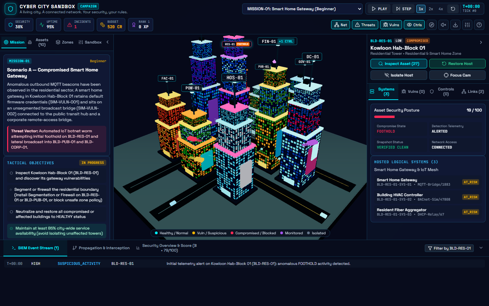
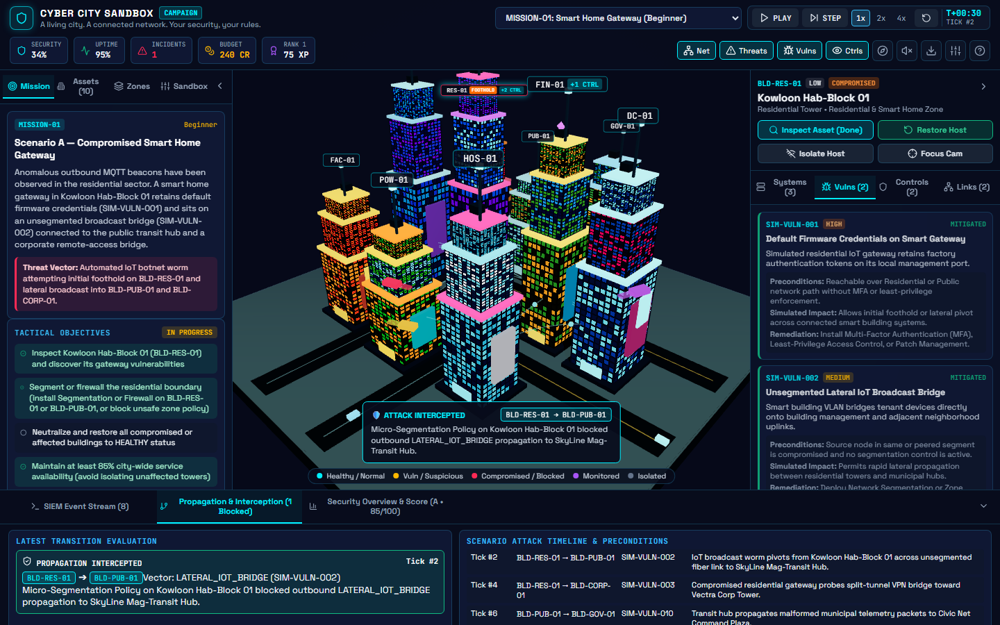
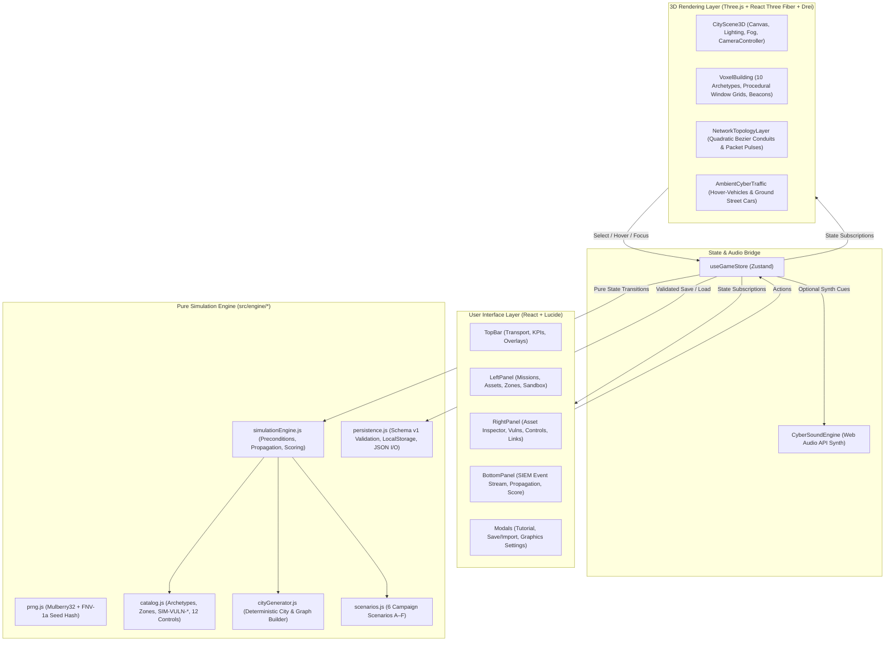
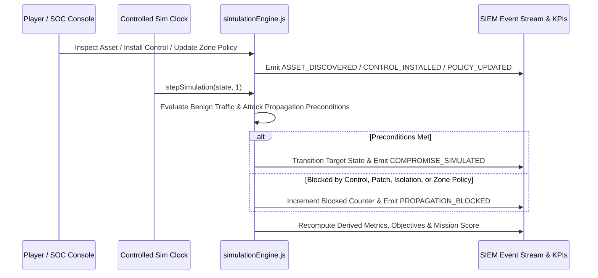
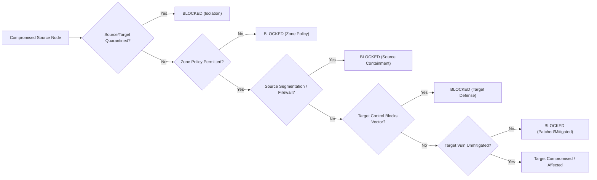
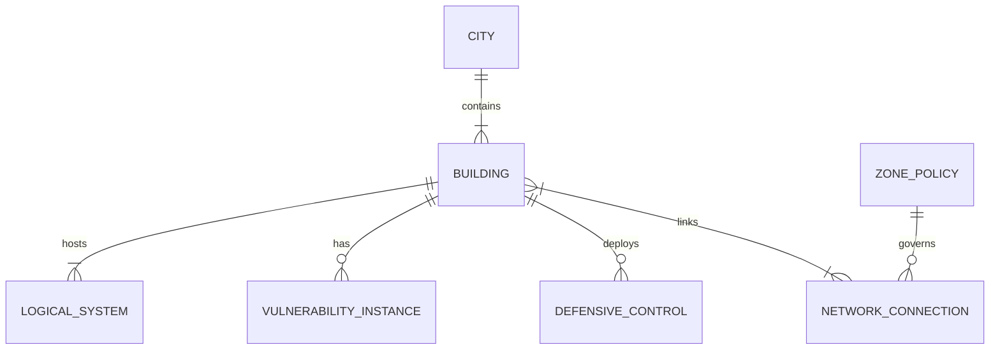

# Cyber City Sandbox

> **A living city. A connected network. Your security, your rules.**
> An interactive 3D cyberpunk voxel city, network topology simulator, and defensive cybersecurity strategy game.

**🚀 Live Demo (Vercel):** [https://cyber-city-sandbox.vercel.app](https://cyber-city-sandbox.vercel.app)



---

## 1. Product Overview

**Cyber City Sandbox** transforms a nighttime cyberpunk voxel metropolis (**Neo-Veridia**) into a functional, interactive cybersecurity digital twin. Instead of staring at a static 2D network diagram, every skyscraper in the 3D diorama represents a real computer system or network segment in the underlying simulation engine:

- **Buildings** represent hosts, enterprise clusters, cloud data centers, smart factories, hospitals, power substations, and municipal gateways.
- **Glowing Conduits** represent active network connections governed by zone segmentation policies and firewall boundaries.
- **Traffic Pulses** reflect live deterministic simulation states (`NORMAL` cyan, `HIGH` electric blue, `SUSPICIOUS` amber, `BLOCKED` red at perimeter shields, and `ISOLATED` slate).
- **Defensive Controls** alter actual graph traversal, vulnerability mitigation, detection telemetry, and recovery snapshot integrity.

---

## 2. Gameplay Loop

1. **Explore the City:** Orbit, pan, zoom, and double-click to focus on any skyscraper in the 3D voxel diorama.
2. **Select & Inspect an Asset:** View hosted logical services (`MQTT-Bridge/1883`, `Postgres-Sim/5432`, `IEC61850-Sim/102`, etc.) and run an **Asset Inspection** to uncover hidden weaknesses (`SIM-VULN-001` through `SIM-VULN-010`).
3. **Analyze Network Topology & Zone Policies:** Inspect connected peers and use the **Zones** tab to block unsafe inter-zone trust bridges while preserving legitimate service dependencies.
4. **Deploy Defensive Controls:** Spend defense budget credits on **Zone Firewalls**, **Micro-Segmentation**, **Hardware MFA**, **Least Privilege (PAM)**, **Automated Patch Management**, **EDR**, **Centralized SIEM Logging**, **Deep Packet Telemetry**, **NIDS**, **Account Shield**, **Anomaly AI**, and **Immutable Backups**.
5. **Simulate & Observe:** Use **PLAY**, **PAUSE**, **STEP (+1 Tick)**, and **1x / 2x / 4x** speed controls to watch deterministic attack scenarios attempt lateral movement and get intercepted by your defenses.
6. **Restore & Debrief:** Recover compromised or ransomware-affected systems from verified clean snapshots, maintain $\ge 85\%$ city service availability, and review your 7-component Mission Score rubric and after-action debrief.

---

## 3. Key Features

- **10 Procedural Voxel Building Archetypes:** Residential Tower, Corporate Skyscraper, Smart Factory, Data Center, Hospital, Financial District Building, Public Transport Hub, Power Facility, Telecommunications Tower, and Government Services Building.
- **Deterministic Seeded City & Graph Generator:** Supports **Small** (20–30 logical systems), **Medium** (50–80 logical systems), and **Large** (100–150 logical systems) city scales. Identical seeds and parameters always produce the exact same city and network topology.
- **6 Playable Campaign Scenarios (Missions A–F):**
  - *Mission 01 (Scenario A)* — Compromised Smart Home Gateway
  - *Mission 02 (Scenario B)* — Corporate Credential Compromise
  - *Mission 03 (Scenario C)* — Ransomware Propagation Simulation
  - *Mission 04 (Scenario D)* — Data Center Exposure
  - *Mission 05 (Scenario E)* — Industrial Network Boundary
  - *Mission 06 (Scenario F)* — Smart City Infrastructure Incident
- **12 Defensive Controls with Realistic Trade-offs:** Controls have credit costs, archetype eligibility rules, prerequisite dependencies (`ids` requires `net_monitoring`; `anomaly_detection` requires `logging`), and distinct mitigation vectors.
- **Bidirectional Security Operations Console (SOC):** Clicking a SIEM event highlights and focuses its building in the 3D city; selecting a building filters the SIEM event feed.
- **Validated Save / Export / Import System:** Automatic `localStorage` persistence plus schema-validated (`schemaVersion: 1`, $\le 512\text{ KB}$) JSON export and import.
- **WebGL Graceful Fallback:** Automatically renders an interactive 2D SVG tactical network map if WebGL is disabled or unavailable.

---

## 4. Screenshots

### Interactive 3D Cyberpunk Voxel City & SOC Console


### Vulnerability Inspection, Defensive Controls & Attack Interception


---

## 5. Technology Stack

| Category | Technology |
| :--- | :--- |
| **Frontend Framework** | React 18 + Vite 6 (ES Modules, JSX) |
| **3D Rendering** | Three.js + `@react-three/fiber` + `@react-three/drei` |
| **State Management** | Zustand 5 |
| **UI Icons & Styling** | `lucide-react` + Custom Cyberpunk HUD CSS |
| **Audio Synthesis** | Native Browser Web Audio API (`CyberSoundEngine`, muted by default) |
| **Testing** | Vitest + React Testing Library + `@testing-library/jest-dom` (`jsdom`) |
| **Persistence** | Browser `localStorage` + Schema-validated JSON Import/Export |
| **Deployment** | Vercel (Static SPA with `vercel.json` rewrite rules) |

---

## 6. Architecture & Mermaid Diagrams

### 6.1 Application Architecture



### 6.2 Simulation Event Lifecycle



### 6.3 Network Propagation & Defensive Interception



### 6.4 City Assets & Network Nodes Relationship



---

## 7. Local Installation & Development Commands

```bash
# 1. Clone the repository
git clone https://github.com/GorillaBrain/cyber-city-sandbox.git
cd cyber-city-sandbox

# 2. Install dependencies
npm install

# 3. Start local development server
npm run dev

# 4. Run unit and UI integration tests
npm test

# 5. Create optimized production bundle
npm run build

# 6. Preview production build locally
npm run preview
```

---

## 8. Campaign Mission Catalogue

| Code | Scenario | Primary Threat Vector | Core Learning Objective |
| :--- | :--- | :--- | :--- |
| `MISSION-01` | **Scenario A — Compromised Smart Home Gateway** | `IOT_GATEWAY_AUTH` (`SIM-VULN-001`) & `LATERAL_IOT_BRIDGE` (`SIM-VULN-002`) | IoT firmware hygiene and segmenting residential networks from municipal/corporate uplinks. |
| `MISSION-02` | **Scenario B — Corporate Credential Compromise** | `CREDENTIAL_REPLAY` (`SIM-VULN-003`) & `PRIVILEGE_ESCALATION_SHARE` (`SIM-VULN-004`) | Stopping identity token replay with Hardware MFA, Least Privilege (PAM), EDR, and SIEM logging. |
| `MISSION-03` | **Scenario C — Ransomware Propagation Simulation** | `UNPATCHED_FILE_SERVICE` (`SIM-VULN-005`) & `BACKUP_TAMPERING` (`SIM-VULN-006`) | Halting lateral SMB/storage encryption simulations and protecting immutable backup snapshots. |
| `MISSION-04` | **Scenario D — Data Center Exposure** | `EXPOSED_DEBUG_API` (`SIM-VULN-007`) | Remediating exposed cloud management APIs with Patch Management, Firewalls, and telemetry. |
| `MISSION-05` | **Scenario E — Industrial Network Boundary** | `PERMISSIVE_OT_BOUNDARY` (`SIM-VULN-008`) | Enforcing IT-to-OT segmentation conduits to protect smart factories and power substations. |
| `MISSION-06` | **Scenario F — Smart City Infrastructure Incident** | Multi-vector (`SIM-VULN-010`, `SIM-VULN-005`) + Benign load spikes | Prioritizing critical infrastructure and distinguishing real attacks from benign traffic surges. |

---

## 9. Detailed Documentation

Additional technical documentation is located in [`docs/`](docs/):

- [`docs/ARCHITECTURE.md`](docs/ARCHITECTURE.md) — Layered architecture and state flow
- [`docs/SIMULATION_ENGINE.md`](docs/SIMULATION_ENGINE.md) — Deterministic tick loop, restoration rules, and scoring rubric
- [`docs/NETWORK_MODEL.md`](docs/NETWORK_MODEL.md) — Security zones, connection properties, and segmentation policies
- [`docs/ATTACK_AND_DEFENSE_RULES.md`](docs/ATTACK_AND_DEFENSE_RULES.md) — Vulnerability catalog (`SIM-VULN-001`..`010`) and 12 defensive controls
- [`docs/CITY_GENERATION.md`](docs/CITY_GENERATION.md) — Seeded PRNG and procedural building archetypes
- [`docs/TESTING.md`](docs/TESTING.md) — Unit and integration test suites
- [`docs/SECURITY_AND_PRIVACY.md`](docs/SECURITY_AND_PRIVACY.md) — Educational safety boundaries, JSON import validation, and privacy model
- [`docs/DEPLOYMENT.md`](docs/DEPLOYMENT.md) — Vercel production deployment guide

---

## 10. Performance Considerations

- **Procedural Canvas Textures:** Skyscraper window grids are synthesized onto lightweight reusable `THREE.CanvasTexture` instances (`NearestFilter`), avoiding thousands of individual window meshes.
- **Decoupled Animation Loop:** High-frequency 3D animations (hover-vehicles, ground cars, beacon pulses, and packet spheres) run inside React Three Fiber `useFrame` hooks by mutating `THREE.Object3D` refs directly—never triggering React state re-renders.
- **Runtime Graphics Toggles:** Players can toggle **Neon Bloom/Lighting**, **Packet Pulses**, **Flying Traffic**, and **Dynamic Shadows** at any time from the Settings modal.

---

## 11. Safety, Privacy & Limitations

- **100% Defensive Simulation:** Contains zero real exploits, malware, network scanners, or external network requests. All vulnerabilities (`SIM-VULN-*`) and systems are synthetic in-memory objects.
- **Local-Only Storage:** Saves and progression remain in browser `localStorage`. Imported JSON files are size-capped (`512 KB`), schema-checked, and sanitized.
- **Model Limitations:** Deterministic state-machine rules are designed for strategic cybersecurity education and do not predict real-world breach probabilities.

---

## 12. Future Roadmap

- Custom scenario editor for authoring and sharing user-created attack timelines.
- Multi-tier sub-building interior rack views for Data Center and Power Substation nodes.
- Replay export to step through completed incident timelines tick-by-tick.

---

## 13. License

Released under the [MIT License](LICENSE).
