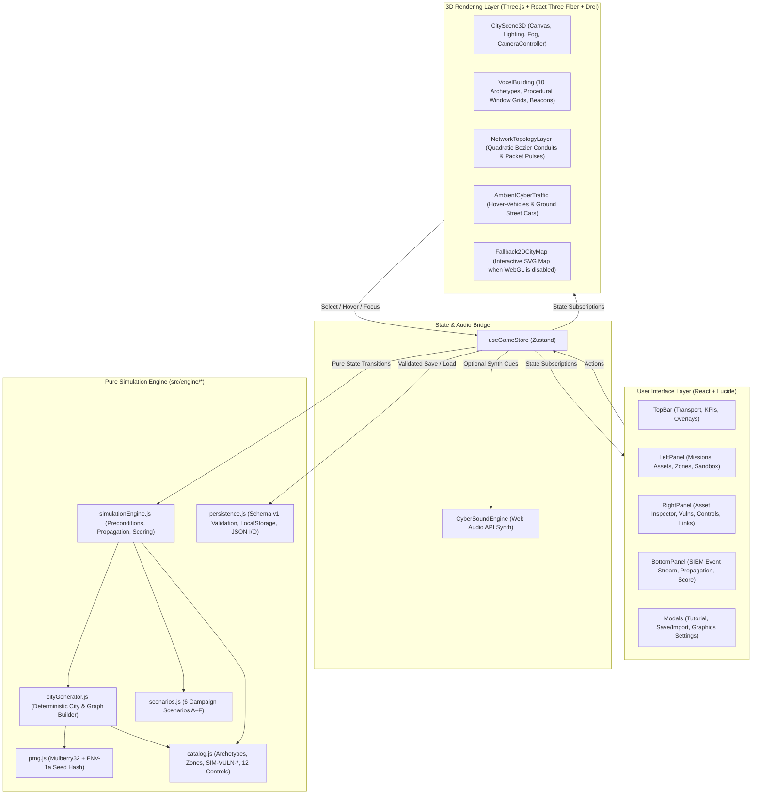
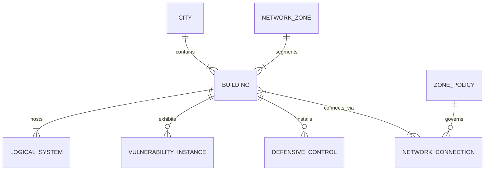

# Architecture Overview — Cyber City Sandbox

**Cyber City Sandbox** is engineered around a strict four-layer separation of concerns so that the cybersecurity simulation engine is 100% deterministic, fast, and independently testable without requiring a WebGL context or DOM renderer.

## 1. High-Level System Architecture

## 2. Layer Responsibilities

| Layer | Directory / Files | Responsibility |
| :--- | :--- | :--- |
| **Simulation Engine** | `src/engine/prng.js` `src/engine/catalog.js` `src/engine/cityGenerator.js` `src/engine/scenarios.js` `src/engine/simulationEngine.js` | Deterministic city generation, network topology construction, zone segmentation policies, vulnerability lifecycle, defensive control enforcement, event-driven attack propagation, service restoration, and mission scoring. Zero Three.js or React dependencies. |
| **Persistence Layer** | `src/engine/persistence.js` | Schema-versioned (`schemaVersion: 1`) serialization, size-bounded (`<= 512 KB`) JSON import validation, input sanitization, and automatic `localStorage` persistence. |
| **State & Audio Bridge** | `src/store/useGameStore.js` `src/utils/soundEffects.js` | Connects pure engine transitions to React components and the 3D scene while isolating high-frequency 3D animation frames from UI re-renders. |
| **Rendering Layer** | `src/components/CityScene3D.jsx` | Renders the nighttime cyberpunk voxel diorama, procedural emissive window textures, neon signage, hover-traffic, and real-time network/threat/control overlays. Includes an automatic 2D interactive SVG fallback when WebGL is unavailable. |
| **User Interface Layer** | `src/components/TopBar.jsx` `src/components/LeftPanel.jsx` `src/components/RightPanel.jsx` `src/components/BottomPanel.jsx` `src/components/Modals.jsx` | Security Operations Center (SOC) console for asset inspection, vulnerability remediation, zone policy management, SIEM event investigation, and mission tracking. |

## 3. Relationship Between City Assets and Network Nodes

Every 3D skyscraper in the scene maps `1:1` by stable ID (`BLD-RES-01`, `BLD-DC-01`, etc.) to a building node in `simState.buildings`, which in turn hosts multiple logical services (`BLD-DC-01-SYS-01`, etc.). Visual indicators (status beacons, quarantine cages, firewall rings, monitoring octahedrons, and fiber pulse colors) are computed directly from the underlying simulation state.
