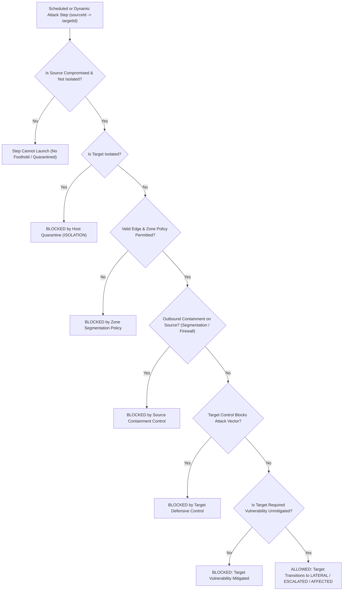

# Attack Propagation & Defensive Interception Rules

All cyber incidents in **Cyber City Sandbox** are simulated using explicit, deterministic graph preconditions. Compromises never spread randomly.

## 1. Propagation Decision Flow

## 2. Fictional Vulnerability Catalog (`SIM-VULN-001` – `SIM-VULN-010`)

| ID | Name | Severity | Attack Vector | Mitigating Controls |
| :--- | :--- | :--- | :--- | :--- |
| `SIM-VULN-001` | Default Firmware Credentials on Smart Gateway | HIGH | `IOT_GATEWAY_AUTH` | `mfa`, `least_privilege`, `patch_mgmt` |
| `SIM-VULN-002` | Unsegmented Lateral IoT Broadcast Bridge | MEDIUM | `LATERAL_IOT_BRIDGE` | `segmentation`, `firewall` |
| `SIM-VULN-003` | Reusable Session Token without MFA Enforcement | HIGH | `CREDENTIAL_REPLAY` | `mfa`, `security_awareness` |
| `SIM-VULN-004` | Excessive Administrative Share Privileges | HIGH | `PRIVILEGE_ESCALATION_SHARE` | `least_privilege`, `edr` |
| `SIM-VULN-005` | Unpatched File-Sync Service Buffer Weakness | CRITICAL | `UNPATCHED_FILE_SERVICE` | `patch_mgmt`, `segmentation` |
| `SIM-VULN-006` | Unprotected Snapshot & Backup Management Interface | CRITICAL | `BACKUP_TAMPERING` | `backup_recovery`, `least_privilege` |
| `SIM-VULN-007` | Publicly Exposed Debug & Management API | CRITICAL | `EXPOSED_DEBUG_API` | `patch_mgmt`, `firewall` |
| `SIM-VULN-008` | Overly Permissive IT-to-OT Gateway Trust | CRITICAL | `PERMISSIVE_OT_BOUNDARY` | `segmentation`, `firewall` |
| `SIM-VULN-009` | Disabled Endpoint & Audit Telemetry | MEDIUM | `BLIND_TELEMETRY` | `logging`, `edr`, `net_monitoring` |
| `SIM-VULN-010` | Unauthenticated Municipal Telemetry Relay | HIGH | `UNSIGNED_TELEMETRY_RELAY` | `patch_mgmt`, `ids`, `firewall` |

## 3. Defensive Controls & Trade-Offs (12 Controls)

1. **Zone Perimeter Firewall (`firewall`, 120 CR)**: Blocks `EXPOSED_DEBUG_API`, `PERMISSIVE_OT_BOUNDARY`, and `UNSIGNED_TELEMETRY_RELAY`. Does not stop stolen credentials over allowed ports.
2. **Micro-Segmentation Policy (`segmentation`, 150 CR)**: Blocks `LATERAL_IOT_BRIDGE`, `UNPATCHED_FILE_SERVICE`, and `PERMISSIVE_OT_BOUNDARY` east-west pivots.
3. **Endpoint Detection & Response (`edr`, 130 CR)**: Blocks `PRIVILEGE_ESCALATION_SHARE` and boosts endpoint detection. Incompatible with legacy residential IoT gateways.
4. **Centralized SIEM & Audit Logging (`logging`, 90 CR)**: Passive visibility control; required for `anomaly_detection` and forensic evidence scoring.
5. **Deep Packet Network Telemetry (`net_monitoring`, 100 CR)**: Passive network visibility; required prerequisite for `ids`.
6. **Hardware Multi-Factor Auth (`mfa`, 110 CR)**: Blocks `CREDENTIAL_REPLAY` and `IOT_GATEWAY_AUTH`.
7. **Least-Privilege Access Control (`least_privilege`, 125 CR)**: Blocks `PRIVILEGE_ESCALATION_SHARE`, `BACKUP_TAMPERING`, and `IOT_GATEWAY_AUTH`.
8. **Automated Patch Management (`patch_mgmt`, 115 CR)**: Remediates software bugs (`SIM-VULN-001`, `005`, `007`, `010`), but cannot fix architectural trust bridges (`SIM-VULN-002`, `008`).
9. **Immutable Backup & Snapshot Vault (`backup_recovery`, 140 CR)**: Blocks `BACKUP_TAMPERING` (`SIM-VULN-006`) and guarantees clean recovery snapshots for system restoration.
10. **Network Intrusion Detection (`ids`, 115 CR)**: Requires `net_monitoring`. Blocks `UNSIGNED_TELEMETRY_RELAY` and raises exploit alerts.
11. **Account Protection & Identity Shield (`security_awareness`, 95 CR)**: Hardens user endpoints against `CREDENTIAL_REPLAY` (`SIM-VULN-003`).
12. **Behavioral Anomaly Detection (`anomaly_detection`, 135 CR)**: Requires `logging`. High-precision correlation for critical infrastructure and data centers.
