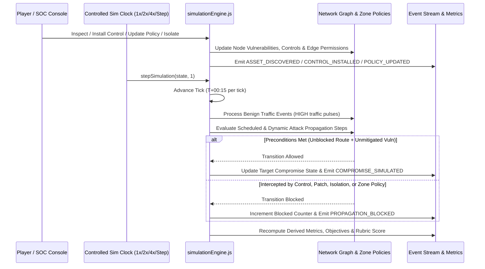

# Simulation Engine — Cyber City Sandbox

The simulation engine (`src/engine/simulationEngine.js`) is a deterministic, discrete-tick, event-driven state machine.

## 1. Simulation Event Lifecycle

## 2. Controlled Time Advancement

- **Discrete Ticks:** Each simulation tick represents 15 seconds of simulated operational time (`T+00:15`, `T+00:30`, etc.).
- **Pause Behavior:** Pausing stops `stepSimulation` invocations completely; game-state time, attack stages, and events never advance in the background while paused.
- **Deterministic Speeds:** `1x`, `2x`, and `4x` adjust the interval between ticks without introducing randomness or frame-rate dependencies.
- **Single-Step Debugging:** The **STEP** control advances the engine by exactly 1 tick so players can inspect each propagation attempt event-by-event.

## 3. Derived Telemetry & Scoring Formula

All metrics displayed in the Security Console are computed dynamically from `simState`:

- **Service Availability (`0–100%`):** Starts at `100%`. Quarantining (`isolated = true`) a building reduces availability based on its criticality (`CRITICAL: -14%`, `HIGH: -9%`, `MEDIUM: -6%`, `LOW: -4%`). Active `AFFECTED` buildings reduce availability by `-12%`, and denying a `legitimateDependency` zone policy reduces availability by `-8%`.
- **Weighted Mission Score (`0–100`, Grades `S` through `D`):**
  - **Investigation Quality (`15%`)**: Ratio of discovered vulnerabilities and asset inspections performed.
  - **Threat Containment (`20%`)**: Penalizes active compromised buildings and rewards blocked propagation attempts.
  - **Critical Infrastructure Protection (`20%`)**: Percentage of `CRITICAL` buildings kept healthy and un-isolated.
  - **Appropriate Security Controls (`15%`)**: Ratio of mitigated vulnerabilities and defensive control coverage.
  - **Service Availability (`15%`)**: City-wide service uptime percentage.
  - **Resource Efficiency (`5%`)**: Remaining defense budget efficiency.
  - **Evidence Preservation (`10%`)**: Coverage of Centralized Logging (`logging`) across city nodes.
